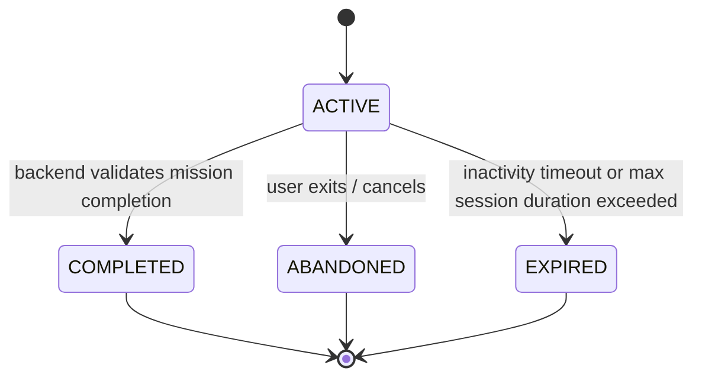
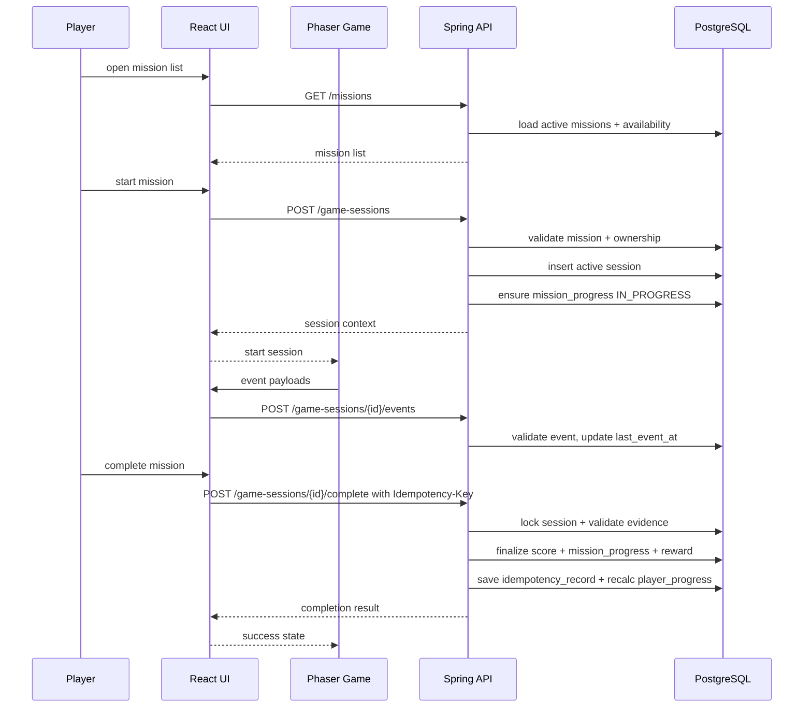

# PHASE 2.4 GAMEPLAY LIFECYCLE

## Purpose

This document defines the accepted runtime lifecycle for mission play, validation, progress updates, reward issuance, save/resume, and idempotency. The backend remains the authoritative source for all progression decisions, while Phaser and React remain integration layers that relay evidence and display results.

## Final accepted enum definitions

GameSessionStatus:
- `ACTIVE`
- `COMPLETED`
- `ABANDONED`
- `EXPIRED`

MissionProgressStatus:
- `AVAILABLE`
- `LOCKED`
- `IN_PROGRESS`
- `COMPLETED`

MissionType:
- `QUIZ`
- `EXPLORATION`
- `STRATEGY`
- `STORY`
- `SIMULATION`

## Mission-type validation model

Each mission type is server-validated with trusted backend logic:

- `QUIZ`: answer correctness, scoring threshold, max attempts, pass/fail rules
- `EXPLORATION`: objective discovery, required checkpoints, completion order
- `STRATEGY`: evaluation of final plan, decision quality, and thresholds
- `STORY`: narrative progression, interaction checkpoints, branching completion
- `SIMULATION`: outcome-based evaluation, scenario completion criteria, drift tolerance

If mission-specific configuration is required, it must be server-side configuration with schema validation and versioning. Client-supplied completion logic is never trusted.

## Session state machine



Valid transitions:
- `ACTIVE -> COMPLETED`
- `ACTIVE -> ABANDONED`
- `ACTIVE -> EXPIRED`
- `ACTIVE -> ACTIVE` during a continued session with validated events

Invalid transitions:
- `COMPLETED -> ACTIVE`
- `ABANDONED -> COMPLETED`
- `EXPIRED -> COMPLETED`
- any transition outside this player/session ownership boundary

## Expiration and stale session policy

Recommended MVP policy:
- inactivity timeout: 30 minutes without a validated event
- absolute ceiling: 120 minutes from `started_at`
- expired sessions are marked `EXPIRED` and `ended_at` is set
- expired sessions are not eligible for reward issuance

## Mission progress initialization

New player:
- `mission_progress` row is created lazily when the player first requests a mission or starts a session
- default state resolves as:
  - `LOCKED` when a prerequisite exists and is not `COMPLETED`
  - `AVAILABLE` when prerequisites are satisfied or absent
- `progress_value = 0`
- `started_at`, `completed_at`, `last_event_at` remain null until relevant progress occurs
- a missing progress row must never be treated as mission completion

Existing player + newly published mission:
- if no progress row exists and prerequisites are satisfied, the status resolves to `AVAILABLE`
- if prerequisites are unmet, it resolves to `LOCKED`
- no broad pre-creation of mission rows for every mission is allowed

Mission list behavior:
- `GET /missions` calculates availability from mission + prerequisite + current progress without writing to the database for every mission row
- `POST /game-sessions` lazily creates or updates `mission_progress` only at the point a mission is actually started

## Session creation and start flow

1. React requests mission list and availability from backend
2. Player chooses a mission that resolves to `AVAILABLE`
3. API creates a `game_session` row with `status = ACTIVE`
4. API ensures `mission_progress` row exists and sets `status = IN_PROGRESS`
5. API returns session context to Phaser for gameplay

## Evidence handling and gameplay events

Gameplay events may contain mission-specific evidence, but they are not authoritative. They are treated as client-provided data subject to validation.

Rules:
- never trust `isCorrect`, `finalScore`, `rewardPoints`, `completedAt`, or any completion flag from the browser
- backend must validate submitted answers against authoritative question data
- backend must validate checkpoint progression against trusted mission rules
- client `metadata` is not authoritative game state; it is only diagnostic or UI context
- event payload may be stored only after backend validation and only if it has business value

For each event type:
- persisted or not: depends on event importance and business value
- validated or not: server validates high-value events only
- affects completion: only backend-derived completion checks may finalize mission success
- updates `last_event_at`: only after validation and persistence
- max payload size: recommended 8 KB / 16 KB maximum for mission event payloads, lower for high-frequency events
- duplicate handling: deduplicate repeated identical evidence packets using event id, timestamp, or hash-based rules

Examples:
- `ANSWER_SUBMITTED`: persisted, validated, may affect completion, updates `last_event_at`
- `CHECKPOINT_REACHED`: persisted if mission logic depends on progression checkpoints, validated against trusted backend progression data
- `PLAYER_MOVEMENT`: not persisted at high frequency; only summarized events may be stored if the business requires it
- `SCENE_TICK`: never persisted as authoritative mission evidence
- `GAME_RENDER_EVENT`: never used to determine player progression or completion

Request example for evidence submission:

```json
{
  "evidence": {
    "questionId": "Q7",
    "selectedOption": "B",
    "attemptCount": 1,
    "answerToken": "a1b2c3"
  },
  "metadata": {
    "source": "phaser-scene",
    "checkpoint": 3
  }
}
```

Response example:

```json
{
  "success": true,
  "data": {
    "sessionId": "f6f17f7a-7b93-43d1-9bbb-13ec44fa3930",
    "accepted": true,
    "eventCount": 1,
    "lastEventAt": "2026-11-17T08:03:00Z"
  }
}
```

## Completion and idempotency

Completion request semantics:
- same `Idempotency-Key` + same request => return the same stored response
- same `Idempotency-Key` + different request => HTTP `409 Conflict`
- different key + already completed session => HTTP `409 Conflict`
- concurrent completion => only one transaction succeeds; all others fail
- validation failure is not a successful completion; it can be recorded in `idempotency_records` as `REJECTED` or `CONFLICT` but it must never update progress to `COMPLETED` or issue a reward
- retryable failures (DB lock timeout, network interruption, transaction rollback) should be retried with the same idempotency key; duplicate success states must be prevented by atomic transaction and unique constraints

Implementation requirements:
- require `Idempotency-Key` on completion requests
- store the key and a request hash in `idempotency_records`
- execute completion under a DB transaction with row locking or optimistic versioning
- insert reward row only once; uniqueness enforced by DB

## Reward and session completion transaction flow

1. validate session ownership and mission rules
2. validate user-submitted evidence against trusted mission-specific rules
3. compute final score server-side
4. mark `game_session` status as `COMPLETED`
5. update `mission_progress` to `COMPLETED` and set `completed_at`
6. insert reward row only if not already present
7. recalculate `player_progress`
8. persist idempotency record and final response

This must all happen within one transaction or equivalent atomic unit. No reward row may be inserted twice because of replay or concurrency.

## Game Session vs Game Save

### Game Session
- runtime instance tied to one player and one mission
- lifecycle state is authoritative for the mission playthrough
- final score and completion outcome must come from server-side determination
- not an arbitrary checkpoint store

### Game Save
- minimal resumable state snapshot
- includes player-specific checkpoint data, inventory, narrative progress, and scene state
- not authoritative for mission completion or reward issuance
- belongs to one player and optionally to a mission/session

Recommended save rules:
- unique save name per player
- JSON payload validated before persist
- max payload size set to a conservative MVP limit (recommended 32 KB to 128 KB)
- versioning / optimistic locking for update operations

## Sequence diagram



## Final design status

This is a design-only definition. No production code or database migrations are modified in this review.
