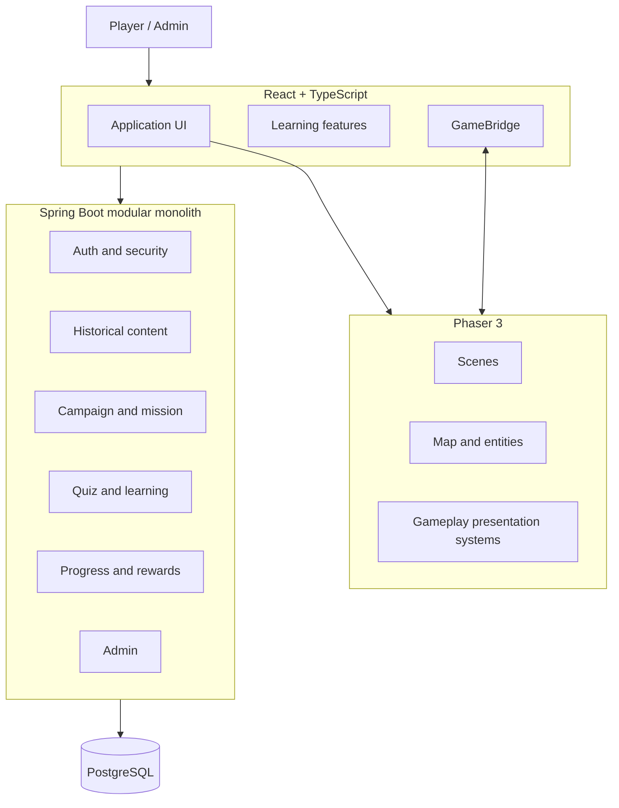

# System Architecture

## Logical architecture

## Frontend modules
Auth, dashboard, eras, history, campaign, missions, learning, quiz, progress, achievements, admin, game-engine.

## Backend modules
Auth, user, era, history, figure, location, campaign, mission, gameplay, resource, learning, quiz, progression, achievement, admin, audit.

## Dependency direction
- Controllers depend on application services.
- Services depend on domain rules and repositories.
- Repositories encapsulate persistence.
- Frontend features call typed API services.
- Phaser communicates through GameBridge and does not own business rules.

## Deployment
Browser → Nginx → static frontend/API reverse proxy → Spring Boot → PostgreSQL. Game assets may be served as static/object assets.

## Observability
Structured logs, correlation IDs, health endpoint, frontend error boundary, no secret logging.
